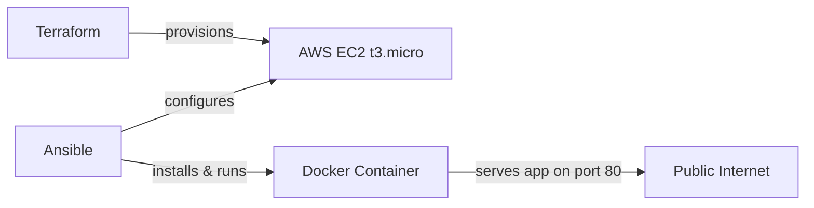

# Terraform + Docker + Ansible — AWS EC2 Deployment

A fully automated infrastructure-as-code pipeline: Terraform provisions an EC2 instance, Ansible configures it, and Docker runs the containerized app.


## Architecture



## What this does
- **Terraform** stands up a free-tier-eligible EC2 instance with the right security group (HTTP/SSH open)
- **Ansible** connects over SSH, installs Docker, and deploys the container
- **Docker** runs the app itself, reachable from any browser or device

## Getting started

```bash
# 1. Provision infrastructure
terraform init
terraform apply

# 2. Configure & deploy with Ansible
ansible-playbook -i inventory.ini deploy.yml

# 3. Tear down when done (avoid any lingering cost)
terraform destroy
```

## Tech stack
Terraform · Ansible · Docker · AWS EC2

## Author
Built by [Derick / SIM](https://github.com/UncleD0886475978)
